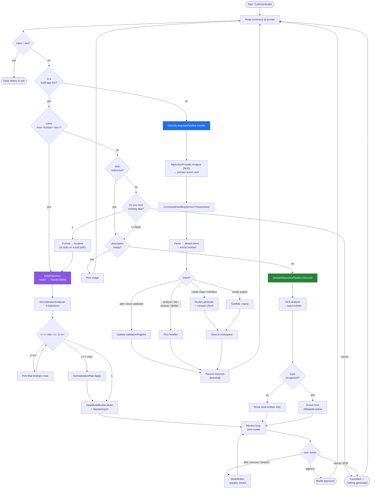
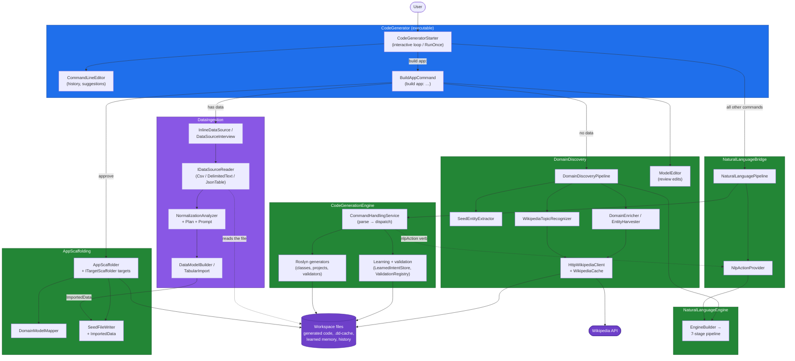
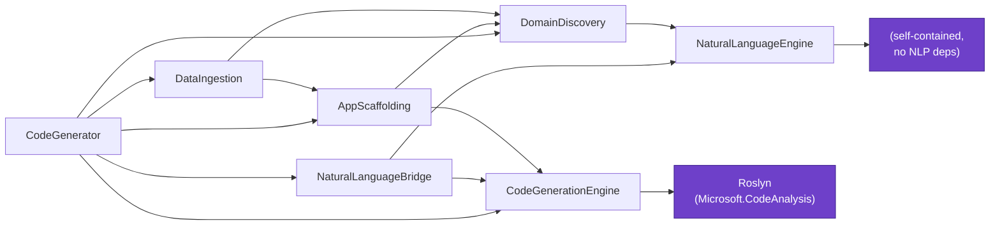
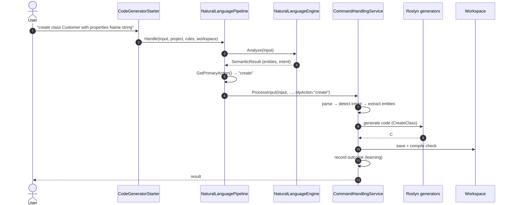
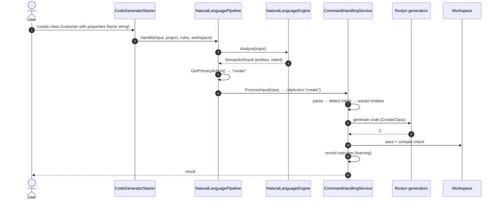
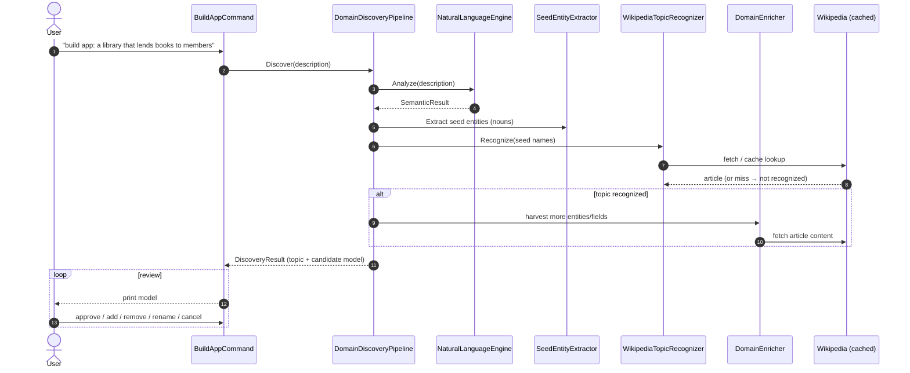

# Architecture

Smart Code Generator turns plain-English commands into .NET code. The
[`CodeGenerator`](../CodeGenerator/README.md) CLI is the only executable; every
other project is a class library it composes.

There are **three paths** through the system:

- **Command path** — most commands (`create class …`, `add validation …`) are
  analyzed by the NaturalLanguageEngine and generated by the CodeGenerationEngine.
- **Discovery path** — `build app: <description>` runs DomainDiscovery to propose
  a domain model, then an interactive review loop.
- **Data path** — `build app` with a data source runs DataIngestion, which reads
  the model out of that data's schema instead of guessing at Wikipedia, and carries
  the rows through as the generated app's seed data.

The last two converge: both produce the same `CandidateDomainModel`, so the review
loop and the scaffolder are shared and know nothing about which path built it.

Both of them wear one of two front ends. An interactive `build app` opens a
workflow page in the browser — eight stages ending in one that starts the
generated application, Blazor Server hosted in-process by the CLI itself
(`CodeGenerator/Web`, which is why that project builds under the Web SDK) — and the
console prints the address and waits for the page to finish. Redirected or piped
input, and `CG_NO_WEB=1`, keep the console wizard and the typed review loop
unchanged. The two long stages report progress rather than going quiet:
discovery and the scaffolder are named steps with the seconds counting up, and
the compiler's output arrives line by line through
`ProcessRunner.RunStreaming` — added alongside `Run`, which reads both streams
to the end and therefore cannot report anything until it is over. The page calls the same services the console path calls; there is no
second pipeline behind it.

> **Note:** the SVGs below are pre-rendered from the Mermaid source in each
> `<details>` block. The data path was added to the Mermaid sources but the images
> have not been re-rendered, so where the two disagree the Mermaid is current.

## End-to-end flow

One trip through the CLI: read a command, branch on whether it's `build app:`,
and either discover a domain model or analyze-and-generate code — then return to
the prompt.


<details>
<summary>Mermaid source</summary>



</details>

## Component & dependency overview


<details>
<summary>Mermaid source</summary>



</details>

**Project references** (compile-time dependencies):


<details>
<summary>Mermaid source</summary>



</details>

## Runtime flow — command path

A normal command is analyzed by NLE first, then handled by the code engine.



<details>
<summary>Mermaid source</summary>



</details>

## Runtime flow — discovery path (`build app:`)


<details>
<summary>Mermaid source</summary>



</details>

## Runtime flow — data path (`build app` with a source)

No diagram is pre-rendered for this path yet; the Mermaid below is the source of
truth.

<details>
<summary>Mermaid source</summary>

```mermaid
sequenceDiagram
    actor User
    participant CLI as BuildAppCommand
    participant Inline as InlineDataSource / DataSourceInterview
    participant Reader as IDataSourceReader
    participant Norm as NormalizationAnalyzer / Plan
    participant Build as DataModelBuilder / TabularImport
    participant Scaf as AppScaffolder / SeedFileWriter

    User->>CLI: build app [: description] [from &lt;format&gt; &lt;loc&gt;]
    CLI->>Inline: parse the tail; if interactive and no inline source, ask
    Inline-->>CLI: DataSourceSpec (or NoData / Cancelled)
    Note over CLI: NoData → unchanged discovery path.<br/>Cancelled → generate nothing.

    CLI->>Reader: Read(spec)
    Reader-->>CLI: TabularTable[] (raw strings, columns typed from values)

    CLI->>Norm: Analyze each table, findings in one numbered list
    Norm-->>User: findings + [n] / n &lt;ids&gt; / [k] / [d] &lt;n&gt;
    User->>CLI: choice (piped runs apply nothing unless `normalize`)
    CLI->>Norm: Apply(chosen)
    Norm-->>CLI: rewritten tables + extracted child/parent entities

    CLI->>Build: Build(tables, chosen) + ToImportedData(tables)
    Build-->>CLI: CandidateDomainModel [Data] + ImportedData
    Note over Build: One DecisionRecord per applied split,<br/>so `why OrderItem` can answer for it.

    loop review
        CLI-->>User: print model
        User->>CLI: approve / add / remove / rename / field / why / cancel
    end

    User->>CLI: approve &lt;target&gt;
    CLI->>Scaf: Scaffold(model, …, importedData)
    Scaf-->>User: project path + Data/Seed/&lt;Class&gt;.json per seeded entity
```

</details>

The data path makes **no Wikipedia call**, so it is fast and works offline. Note
the ordering: seed files are written *after* the review loop, and `SeedFileWriter`
projects through each class's final property list — which is what makes every
review-loop edit absorbed automatically rather than needing its own handling.

## Inside the NaturalLanguageEngine

The engine runs seven ordered stages over a shared `AnalysisContext`; assembly
lives in [`EngineBuilder`](../NaturalLanguageEngine/Core/EngineBuilder.cs).



<details>
<summary>Mermaid source</summary>


</details>

## Where things are written

| Location | Written by | Contents |
| --- | --- | --- |
| `<workspace>/<Project>/…` | CodeGenerationEngine | Generated `.csproj`, classes, validators. |
| `<workspace>/<AppName><suffix>/…` | AppScaffolding | A runnable generated app: model classes, store, repositories, validators, and the target's front end. |
| `<workspace>/<AppName><suffix>/Data/Seed/` | AppScaffolding | `<Class>.json` per entity when the app was built from the user's own data — registered as copied-to-output content and loaded by the generated seeder on first run. |
| `<workspace>/.dd-cache/` | DomainDiscovery | Cached Wikipedia article content. |
| `<workspace>/` (learned memory) | CodeGenerationEngine | Per-workspace learned intent store. |
| `<workspace>/.codegen_history` | CodeGenerator | Encrypted command history. |

The workspace root defaults to the current directory and can be overridden with
the `PROJECTPATH` environment variable — see the [root README](../README.md).
