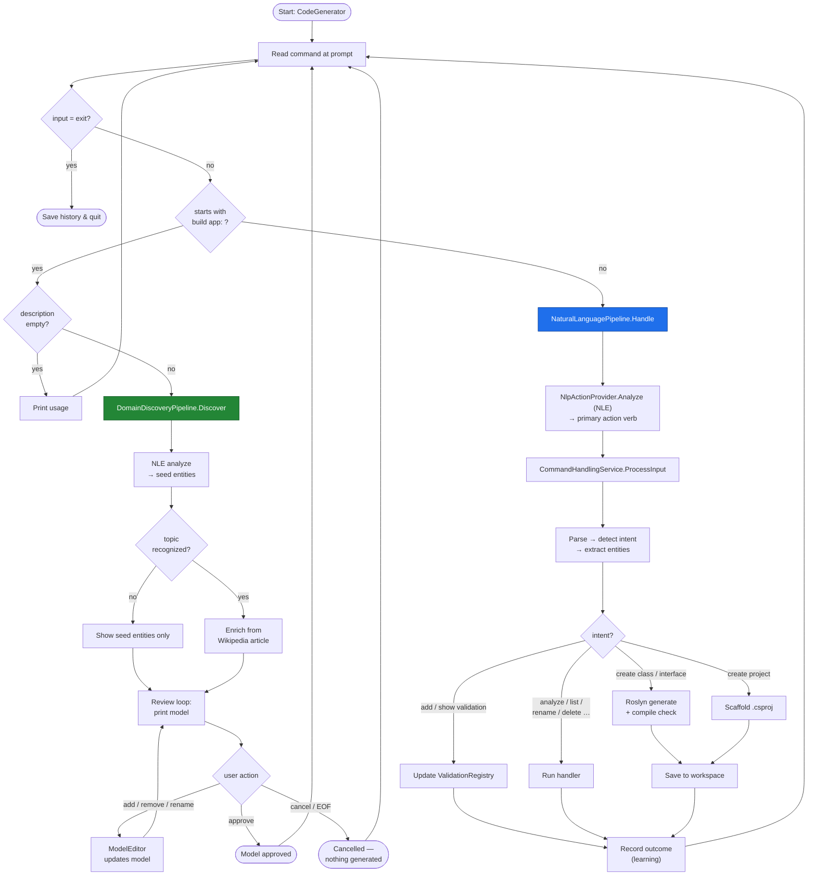
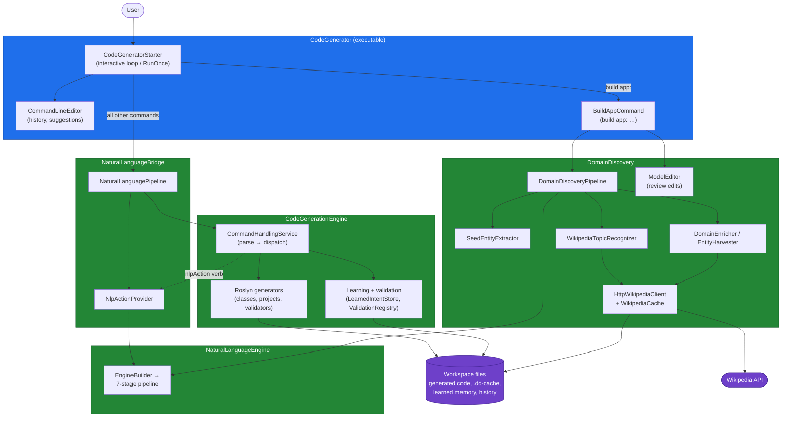
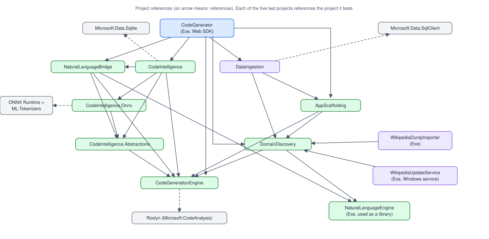
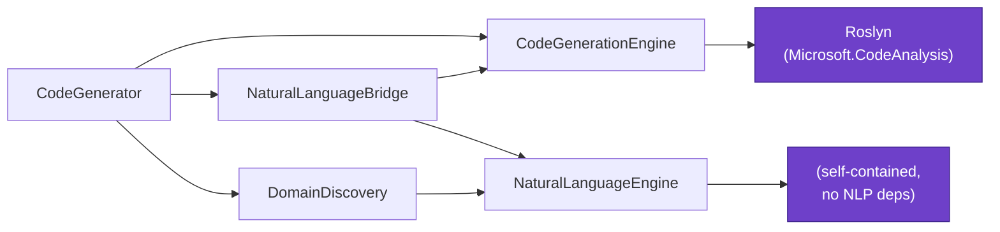
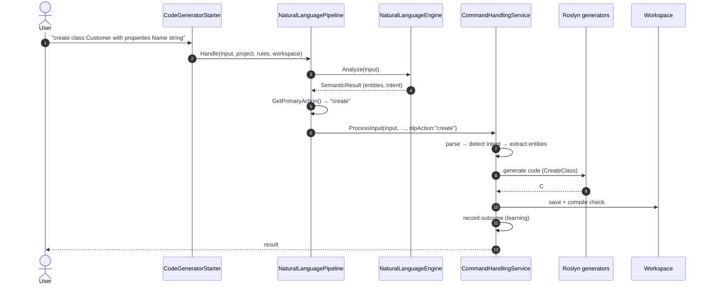
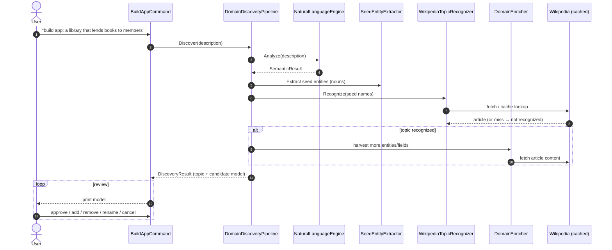

# Architecture

Smart Code Generator turns plain-English commands into .NET code. The
[`CodeGenerator`](../CodeGenerator/README.md) CLI is the only executable; every
other project is a class library it composes.

There are **two paths** through the system:

- **Command path** — most commands (`create class …`, `add validation …`) are
  analyzed by the NaturalLanguageEngine and generated by the CodeGenerationEngine.
- **Discovery path** — `build app: <description>` runs DomainDiscovery to propose
  a domain model, then an interactive review loop.

## End-to-end flow

One trip through the CLI: read a command, branch on whether it's `build app:`,
and either discover a domain model or analyze-and-generate code — then return to
the prompt.

Mermaid source

## Component & dependency overview

Mermaid source

**Project references** (compile-time dependencies):

Mermaid source

## Runtime flow — command path

A normal command is analyzed by NLE first, then handled by the code engine.

Mermaid source

## Runtime flow — discovery path (`build app:`)

Mermaid source

## Inside the NaturalLanguageEngine

The engine runs seven ordered stages over a shared `AnalysisContext`; assembly
lives in [`EngineBuilder`](../NaturalLanguageEngine/Core/EngineBuilder.cs).

Mermaid source

## Where things are written

| Location | Written by | Contents |
| --- | --- | --- |
| `<workspace>/<Project>/…` | CodeGenerationEngine | Generated `.csproj`, classes, validators. |
| `<workspace>/.dd-cache/` | DomainDiscovery | Cached Wikipedia article content. |
| `<workspace>/` (learned memory) | CodeGenerationEngine | Per-workspace learned intent store. |
| `<workspace>/.codegen_history` | CodeGenerator | Encrypted command history. |

The workspace root defaults to the current directory and can be overridden with
the `PROJECTPATH` environment variable — see the [root README](../README.md).
