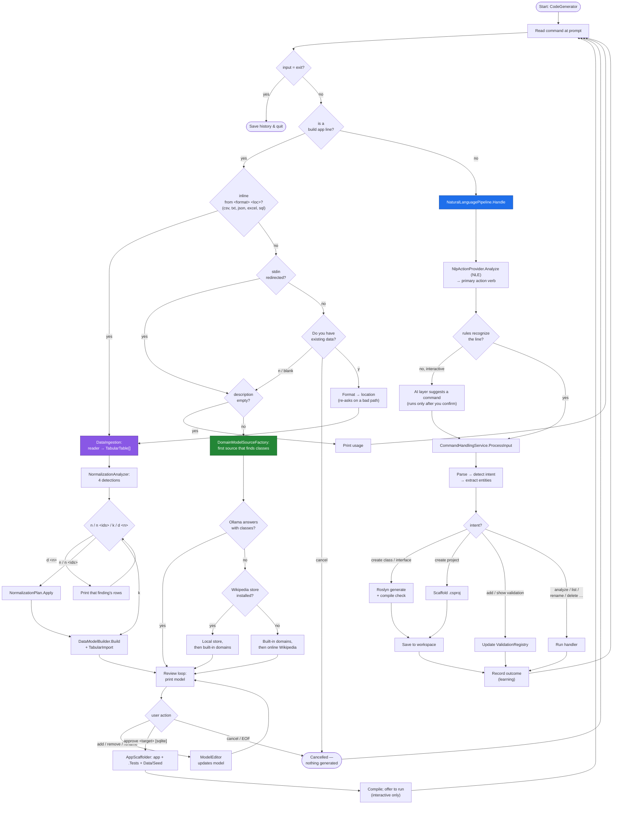
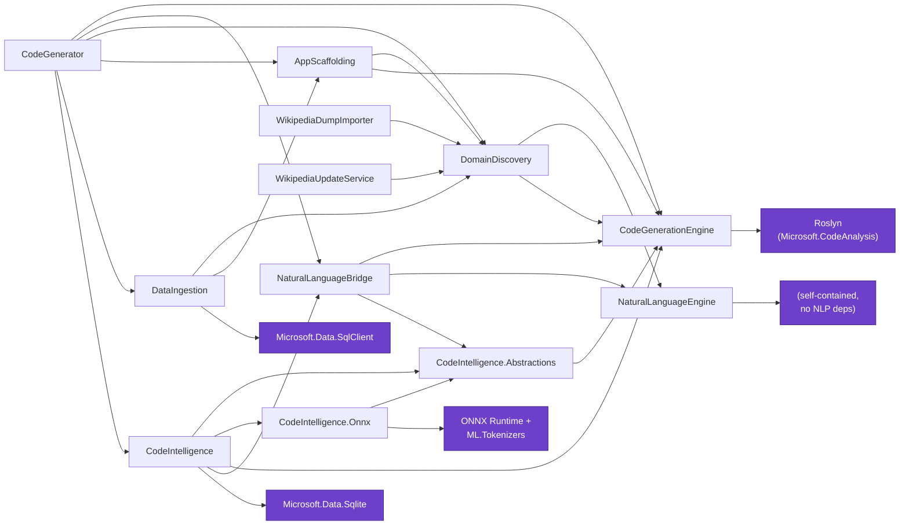
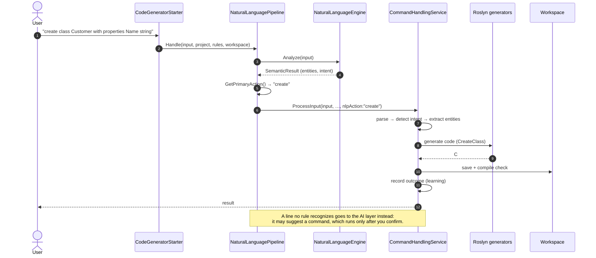
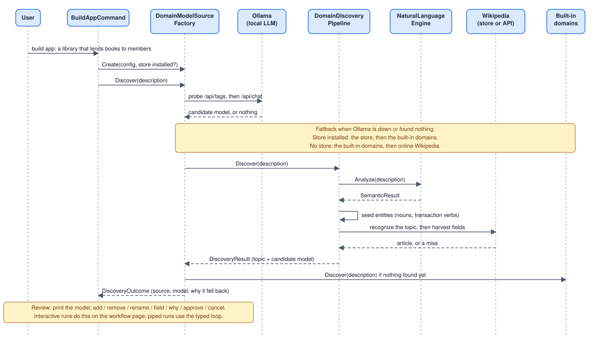
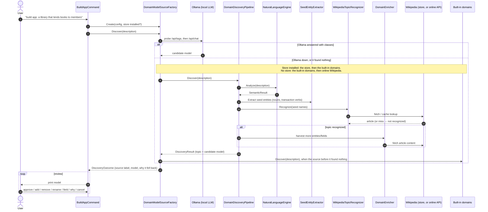
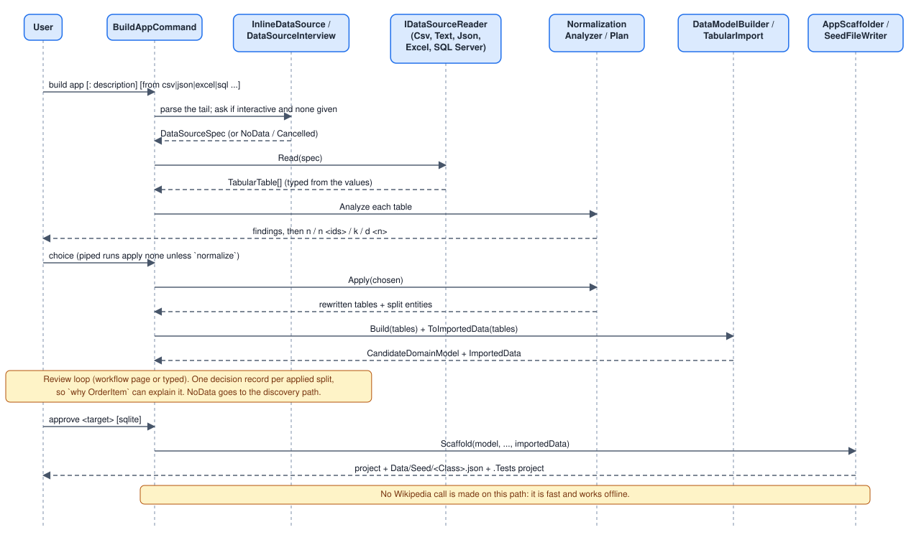
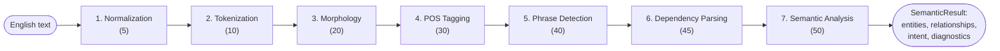

# Architecture

Smart Code Generator turns plain-English commands into .NET code. The
[`CodeGenerator`](../CodeGenerator/README.md) CLI is the executable you run; the
other projects are class libraries it composes, apart from executables that
look after the local Wikipedia store —
[`WikipediaDumpImporter`](../WikipediaDumpImporter/README.md), which builds it,
and `WikipediaUpdateService`, a Windows service that keeps it up to date.
`NaturalLanguageEngine` is also built as an `Exe`, but the CLI and
`DomainDiscovery` use it as a library. Twelve projects hold the product and five
test projects cover it; the solution is `SmartCodeGenerator/SmartCodeGenerator.slnx`.

Beneath the command path sits an **AI layer** (`CodeIntelligence`, on by
default): a line the rules do not recognize is embedded by a local ONNX model
(`CodeIntelligence.Onnx`), its nearest known phrasings are found in a SQLite
index, and the command they point to is offered as a suggestion that runs only
once confirmed (a piped run never asks, so never uses it). `NaturalLanguageBridge` sees it only through the contracts in
`CodeIntelligence.Abstractions`, so a model that cannot load means no
suggestion, not a failure.

There are **three paths** through the system:

- **Command path** — most commands (`create class …`, `add validation …`) are
  analyzed by the NaturalLanguageEngine and generated by the CodeGenerationEngine.
- **Discovery path** — `build app: <description>` runs DomainDiscovery to propose
  a domain model, then an interactive review loop.
- **Data path** — `build app` with a data source runs DataIngestion, which reads
  the model out of that data's schema instead of guessing at Wikipedia, and carries
  the rows through as the generated app's seed data.

The last two converge: both produce the same `CandidateDomainModel`, so the review
loop and the scaffolder are shared and know nothing about which path built it.

Both of them wear one of two front ends. An interactive `build app` opens a
workflow page in the browser — ten stages ending in one that starts the
generated application, and the stages are also the navigation: a panel offers
its forward step through a `StageNavigation` the diagram draws inside the box
being answered, which is why no panel has a Next button. A step with a name of
its own (`Generate`) is never taken by clicking the stage ahead, and
`BuildSession.HoldsAnAnswer` decides whether a node the user merely passed
through is recorded as done — without it the diagram would claim a project was
generated when nothing was written. Blazor Server hosted
in-process by the CLI itself
(`CodeGenerator/Web`, which is why that project builds under the Web SDK) — and the
console prints the address and waits for the page to finish. Redirected or piped
input, and `CG_NO_WEB=1`, keep the console wizard and the typed review loop
unchanged. The two long stages report progress rather than going quiet:
discovery and the scaffolder are named steps with the seconds counting up, and
the compiler's output arrives line by line through
`ProcessRunner.RunStreaming` — added alongside `Run`, which reads both streams
to the end and therefore cannot report anything until it is over. The page calls the same services the console path calls; there is no
second pipeline behind it.

> **Note:** the SVGs below are drawn by hand and match the solution as it stands:
> twelve source projects, five data-source formats, the AI layer and the
> browser pages. The Mermaid in each `<details>` block is the same picture as
> text, for reading in a diff. If an image and its Mermaid ever disagree, fix
> the one that is wrong; do not trust either blindly.

## End-to-end flow

One trip through the CLI: read a command, branch on whether it's `build app:`,
and either discover a domain model or analyze-and-generate code — then return to
the prompt.


<details>
<summary>Mermaid source</summary>



</details>

## Component & dependency overview

```mermaid
flowchart TD
    user([User])

    subgraph cli["CodeGenerator (executable)"]
        starter["CodeGeneratorStarter<br/>(interactive loop / RunOnce)"]
        editor["CommandLineEditor<br/>(history, suggestions)"]
        buildapp["BuildAppCommand<br/>(build app: …)"]
        web["Web: workflow page, chat page,<br/>relationships page (Blazor Server)"]
        scripts["Scripts: save session / run<br/>(ScriptBuildApp child process)"]
    end

    subgraph bridge["NaturalLanguageBridge"]
        pipeline["NaturalLanguagePipeline"]
        provider["NlpActionProvider"]
    end

    subgraph cge["CodeGenerationEngine"]
        handling["CommandHandlingService<br/>(parse → dispatch)"]
        gen["Roslyn generators<br/>(classes, projects, validators)"]
        learn["Learning + validation<br/>(LearnedIntentStore, PhraseCandidates,<br/>ValidationRegistry)"]
        undo["UndoJournal<br/>(undo / redo)"]
    end

    subgraph ci["CodeIntelligence (AI layer)"]
        ailayer["AiLayer"]
        resolver["RetrievalIntentResolver"]
        onnx["OnnxEmbeddingProvider<br/>(CodeIntelligence.Onnx)"]
        vectors["SqliteVectorStore<br/>(ai-index.db)"]
    end

    subgraph nle["NaturalLanguageEngine"]
        engine["EngineBuilder →<br/>7-stage pipeline (orders 5 to 50)"]
    end

    subgraph dd["DomainDiscovery"]
        factory["DomainModelSourceFactory<br/>(chooses, falls back)"]
        ollamasrc["OllamaDomainModelSource"]
        bundledsrc["BundledDomainSource<br/>(25 built-in domains)"]
        ddp["DomainDiscoveryPipeline"]
        seed["SeedEntityExtractor<br/>(+ TransactionVerbs)"]
        topic["WikipediaTopicRecognizer"]
        enrich["DomainEnricher / EntityHarvester"]
        editor2["ModelEditor<br/>(review edits)"]
        dump["DumpWikipediaClient<br/>+ WikipediaStore"]
        wiki["HttpWikipediaClient<br/>+ WikipediaCache"]
    end

    subgraph di["DataIngestion"]
        inline["InlineDataSource /<br/>DataSourceInterview"]
        readers["IDataSourceReader<br/>(Csv / DelimitedText / JsonTable /<br/>Excel / SqlServer)"]
        analyzer["NormalizationAnalyzer<br/>+ Plan + Prompt"]
        dmb["DataModelBuilder /<br/>TabularImport"]
    end

    subgraph asc["AppScaffolding"]
        mapper["DomainModelMapper"]
        scaffolder["AppScaffolder<br/>+ ITargetScaffolder targets<br/>(JSON or SQLite store)"]
        seedwriter["SeedFileWriter<br/>+ ImportedData"]
    end

    fs[("Workspace files<br/>generated code, .dd-cache,<br/>.codegen, history")]
    wikipedia([Wikipedia API])
    ollama([Ollama, local])
    storedb[("Wikipedia store<br/>%ProgramData%")]

    user --> starter
    starter --> editor
    starter -->|"build app:"| buildapp
    starter -->|"all other commands"| pipeline

    pipeline --> provider
    provider --> engine
    pipeline --> handling
    handling --> gen
    handling --> learn
    handling -.->|"nlpAction verb"| provider
    pipeline -.->|"unrecognized line"| resolver
    starter --> ailayer
    ailayer --> resolver
    resolver --> onnx
    resolver --> vectors
    starter --> undo

    buildapp -->|"no data"| factory
    factory --> ollamasrc
    factory --> ddp
    factory --> bundledsrc
    ollamasrc --> ollama
    ddp --> seed
    ddp --> topic
    ddp --> enrich
    ddp --> engine
    topic --> wiki
    enrich --> wiki
    topic -.->|"store installed"| dump
    enrich -.-> dump
    dump --> storedb
    buildapp --> editor2
    wiki --> wikipedia

    buildapp --> web
    buildapp --> scripts
    buildapp -->|"has data"| inline
    inline --> readers
    readers --> analyzer
    analyzer --> dmb
    readers -.->|"reads the file / database"| fs

    buildapp -->|approve| scaffolder
    dmb -->|"ImportedData"| seedwriter
    scaffolder --> mapper
    scaffolder --> seedwriter
    scaffolder --> fs

    gen --> fs
    learn --> fs
    wiki --> fs

    classDef ext fill:#6e40c9,stroke:#3f228f,color:#fff
    class wikipedia,fs,ollama,storedb ext

    style cli fill:#1f6feb,stroke:#0b3d91,color:#fff
    style bridge fill:#238636,stroke:#0f5323,color:#fff
    style cge fill:#238636,stroke:#0f5323,color:#fff
    style ci fill:#238636,stroke:#0f5323,color:#fff
    style nle fill:#238636,stroke:#0f5323,color:#fff
    style dd fill:#238636,stroke:#0f5323,color:#fff
    style di fill:#8957e5,stroke:#4c2889,color:#fff
    style asc fill:#238636,stroke:#0f5323,color:#fff
```



<details>
<summary>Mermaid source</summary>



</details>

**Project references** (compile-time dependencies). The five test projects
(`CodeGenerator.Tests`, `NaturalLanguageEngine.Tests`, `DomainDiscovery.Tests`,
`DataIngestion.Tests`, `CodeIntelligence.Tests`) each reference what they test and are left
off the picture:


<details>
<summary>Mermaid source</summary>



</details>

## Runtime flow — command path

A normal command is analyzed by NLE first, then handled by the code engine.


<details>
<summary>Mermaid source</summary>



</details>

## Runtime flow — discovery path (`build app:`)



<details>
<summary>Mermaid source</summary>



</details>

## Runtime flow — data path (`build app` with a source)



<details>
<summary>Mermaid source</summary>

```mermaid
sequenceDiagram
    actor User
    participant CLI as BuildAppCommand
    participant Inline as InlineDataSource / DataSourceInterview
    participant Reader as IDataSourceReader
    participant Norm as NormalizationAnalyzer / Plan
    participant Build as DataModelBuilder / TabularImport
    participant Scaf as AppScaffolder / SeedFileWriter

    User->>CLI: build app [: description] [from csv|txt|json|excel|sql &lt;loc&gt;]
    CLI->>Inline: parse the tail; if interactive and no inline source, ask
    Inline-->>CLI: DataSourceSpec (or NoData / Cancelled)
    Note over CLI: NoData → unchanged discovery path.<br/>Cancelled → generate nothing.

    CLI->>Reader: Read(spec)
    Reader-->>CLI: TabularTable[] (raw strings, columns typed from values)

    CLI->>Norm: Analyze each table, findings in one numbered list
    Norm-->>User: findings + [n] / n &lt;ids&gt; / [k] / [d] &lt;n&gt;
    User->>CLI: choice (piped runs apply nothing unless `normalize`)
    CLI->>Norm: Apply(chosen)
    Norm-->>CLI: rewritten tables + extracted child/parent entities

    CLI->>Build: Build(tables, chosen) + ToImportedData(tables)
    Build-->>CLI: CandidateDomainModel [Data] + ImportedData
    Note over Build: One DecisionRecord per applied split,<br/>so `why OrderItem` can answer for it.

    loop review
        CLI-->>User: print model
        User->>CLI: approve / add / remove / rename / field / why / cancel
    end

    User->>CLI: approve &lt;target&gt;
    CLI->>Scaf: Scaffold(model, …, importedData)
    Scaf-->>User: project path + Data/Seed/&lt;Class&gt;.json per seeded entity
```

</details>

The data path makes **no Wikipedia call**, so it is fast and works offline. Note
the ordering: seed files are written *after* the review loop, and `SeedFileWriter`
projects through each class's final property list — which is what makes every
review-loop edit absorbed automatically rather than needing its own handling.

## Inside the NaturalLanguageEngine

The engine runs seven ordered stages over a shared `AnalysisContext`; assembly
lives in [`EngineBuilder`](../NaturalLanguageEngine/Core/EngineBuilder.cs).


<details>
<summary>Mermaid source</summary>



</details>

## The browser pages and session scripts

Three pages are served from the CLI process itself, each by a host built on
`LoopbackHost` (Kestrel on a loopback port, a one-off token in the address, alive for
exactly one command): the **workflow page** (`BuildAppWebHost`, ten stages), the
**chat page** (`ChatWebHost`) and the **relationships page**. `CodeGenerator` therefore
builds under the Web SDK.

The chat page is one `ChatSession` per host, so two tabs see one conversation. It runs
commands one at a time, because the output capture swaps the process-wide `Console.Out`
and the engine keeps static state. Its tree (`ProjectTree`) draws the registered
projects, and Undo and Redo sit beside Send. A tab closed and not replaced ends the
session, so the console never waits on a page nobody has open.

**Session scripts** record and replay a session. `save session <file>` writes the commands
that worked and changed something to a `.cgs` file; `run <file>` replays it and puts the
workspace back if a line fails. A `build app` block cannot run in-process, since the
command reads its input in many places, so `ScriptBuildApp` starts a **child copy of the
tool** with the block's lines piped in, `PROJECTPATH` set and `CODEGEN_SCRIPT_STEP=1` in its
environment. A piped CLI exits 0 whatever happens, so success is read from the line it
prints (`Generated project at`), never from the exit code.

## The AI layer and phrase learning

`AiLayer` loads the ONNX model and opens `ai-index.db`. It builds the index itself at
startup, and again when the content hash of the phrase corpus it ships differs from what
was indexed; `ai reindex` forces it, and `ai status` says `REINDEX REQUIRED` when one is
due. Every reading is written to a decision log, which `ai why` explains. `ai mode` names
how unrecognized input is read; only `retrieval` works today. `ai disable` turns the layer
off, and the next start prints `AI: off (disabled - run 'ai enable')`.

The CLI also learns commands from use. When a line is not understood and the next line
works, `PhraseCandidates` records the pair in `.codegen/phrase-candidates.jsonl`; `show
learning` groups them for review. Nothing there changes what the tool understands. A phrase
ships only after a person copies it into `CodeIntelligence/Corpus/learned-phrases.tsv`
(embedded in the build) and the golden-set test still passes.

## Tests and CI

CI (`.github/workflows/ci.yml`) restores, builds and tests `SmartCodeGenerator.slnx` in
Release on `windows-latest`, with Git LFS checkout (the ONNX weights are in LFS) and
`-warnaserror`. Two tests compare a committed file with one generated from the code, and the
environment variables below regenerate them:

| Variable | Rewrites |
| --- | --- |
| `UPDATE_COMMAND_DOCS=1` | `docs/commands.md`, from `CommandDictionary`. |
| `UPDATE_MANUAL_APPENDIX=1` | The command appendix of the user manual. |

Run them as `UPDATE_COMMAND_DOCS=1 dotnet test CodeGenerator.Tests`. The same dictionary
feeds the in-tool `help`, so the reference, the manual and the prompt cannot drift apart.

## Where things are written

| Location | Written by | Contents |
| --- | --- | --- |
| `<workspace>/<Project>/…` | CodeGenerationEngine | Generated `.csproj`, classes, validators. |
| `<workspace>/<Project>/DeletedClasses/` | CodeGenerationEngine | Classes moved there by `delete class`, timestamped, for `restore class`. |
| `<workspace>/deleted-classes.json` | CodeGenerationEngine | Which deleted class came from where (`DeletedClassRegistry`). |
| `<workspace>/<AppName><suffix>/…` | AppScaffolding | A runnable generated app: model classes, store, repositories, validators, and the target's front end. |
| `<workspace>/<AppName><suffix>/.codegen/generated-files.txt` | AppScaffolding | The files a generation wrote, with hashes (`GeneratedFilesManifest`), so a regeneration can remove what a renamed or removed class left behind without touching files you edited. |
| `<workspace>/<AppName><suffix>.Tests/` | AppScaffolding | The xUnit project written beside every generated app (`dotnet test` runs it). |
| `<workspace>/<AppName><suffix>/Data/Seed/` | AppScaffolding | `<Class>.json` per entity when the app was built from the user's own data — registered as copied-to-output content and loaded by the generated seeder on first run. |
| `<workspace>/.codegen/validation-rules.json` | CodeGenerationEngine | The validation rules, rewritten by `ValidationRuleFile` after each add or remove. |
| The path you give after `from` | none | A data source (a CSV, text, JSON or Excel file, or a SQL Server connection) is **read in place**; nothing is copied or changed, and only the seed rows reach the generated app. |
| `<workspace>/.dd-cache/` | DomainDiscovery | Cached Wikipedia article content, when discovery reads the online API. |
| `<workspace>/.codegen/learned.json` | CodeGenerationEngine | Learned command signatures and how often each worked (`LearnedIntentStore`; `show learning`, `reset learning`). |
| `<workspace>/.codegen/phrase-candidates.jsonl` | CodeGenerationEngine | Each line that was not understood, paired with the next command that worked (`PhraseCandidates`). |
| `<workspace>/.codegen/phrase-candidates.tsv` | CodeGenerationEngine | The same pairs grouped for review, written by `show learning`. |
| `<workspace>/.codegen/app-profile.json` | CodeGenerator | The customization answers an interactive `build app` offers back next time (`CustomizationDefaults`). |
| `<workspace>/.codegen/build-in-progress.json` | CodeGenerator | The unfinished workflow-page build, saved after every change so the next `build app` can resume it (`BuildSnapshotStore`). |
| `<workspace>/.codegen/workflow-theme.json` | CodeGenerator | The theme chosen on the workflow page (`WorkflowThemeStore`). |
| `<workspace>/<name>.cgs` | CodeGenerator | A script written by `save session` and read by `run`; the name is resolved against the workspace (`ScriptPath`). |
| `<workspace>/.codegen_history` | CodeGenerator | Command history, one command per line. |
| `%TEMP%\codegen_undo_*` | CodeGenerationEngine | The shadow copy `UndoJournal` keeps of what a command changed, for `undo` and `redo`, for the session. |
| `%TEMP%\codegen_snapshot_*` | CodeGenerationEngine | The pre-`batch` snapshot `WorkspaceSnapshot` restores when a batch fails. |
| `%ProgramData%\SmartCodeGenerator\Wikipedia\enwiki-full.db` | WikipediaDumpImporter, WikipediaUpdateService | The local Wikipedia store, with `update-status.json` beside it. A `StorePath` in `discovery.json` — the program's own, or the shared `%ProgramData%\SmartCodeGenerator\discovery.json` — moves it. |
| Beside the executable | CodeGenerator, CodeIntelligence | `ProjectManager.dat` (the project registry), `intents.json`, `ai.json` (AI settings) and `ai-index.db` (the AI phrase index and its decision log). |

The workspace root defaults to the current directory and can be overridden with
the `PROJECTPATH` environment variable — see the [root README](../README.md).
